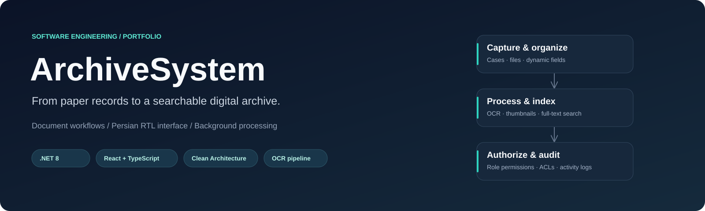
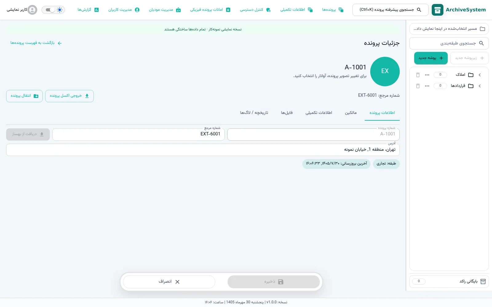
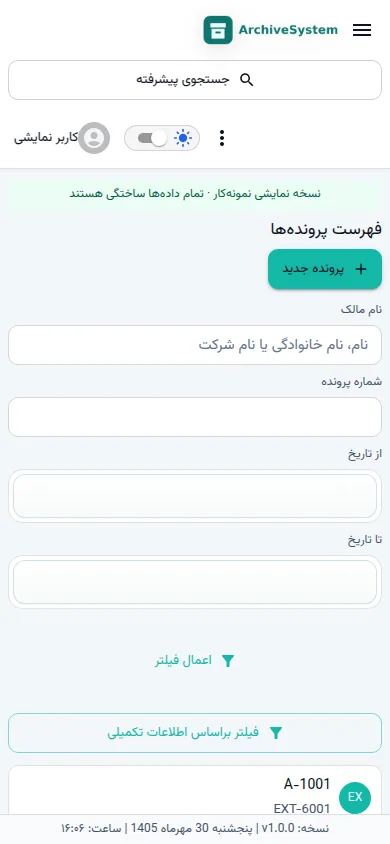

<p align="center"></p>

<p align="center">
  
  
  
  
  
</p>

# ArchiveSystem

<!-- project-contact:start -->
**Work with Yosof Omrani:** [Email a project inquiry](mailto:aliomrani916@gmail.com) · **aliomrani916@gmail.com** · [Services & contact](https://ali771025.github.io/software-portfolio/en/contact/) · [Portfolio walkthrough](https://ali771025.github.io/software-portfolio/en/work/ArchiveSystem/)
<!-- project-contact:end -->


**An on-premises document and case management platform, connecting physical records with searchable digital workflows.**

ArchiveSystem brings classification trees, case records, versioned files, dynamic metadata, access policies, and background document processing into one Persian-first workspace. This repository presents a compact, sanitized source snapshot with a standalone UI showcase and documented backend architecture.

[فارسی](docs/README.fa.md) · [Architecture](docs/ARCHITECTURE.md) · [Run locally](docs/GETTING_STARTED.md) · [Engineering walkthrough](docs/ENGINEERING.md) · [Verification](docs/VALIDATION.md)

## See the application

The following are captures of the actual React application in **showcase mode**. All displayed records are synthetic. They demonstrate the interface, not a connection to a production database or measured OCR accuracy.

| Archive workspace | Case details |
| --- | --- |
|  |  |

<p align="center"></p>

## What it handles

| Capability | Implementation represented in the source |
| --- | --- |
| Structured records | Hierarchical classifications, case records, owners, and physical case loans. |
| Document lifecycle | File metadata, versions, tags, upload sessions, and soft-delete handling. |
| Flexible forms | Classification-specific field definitions, groups, options, and typed case values. |
| Document processing | OCR, PDF native-text extraction, previews, and search indexing in separate workers. |
| Access control | ASP.NET Identity/JWT, role permissions, classification and tag ACLs, plus audit records. |
| Persian-first UX | Right-to-left layout, Persian typography, localized dates, forms, and responsive navigation. |
| Desktop scanning | A separate localhost Scanner Bridge for NAPS2-driven WIA/TWAIN workflows on Windows. |
| Operational integration | SQL Server persistence, MinIO/S3 storage, RabbitMQ, OpenSearch, and an optional Redis cache. |

## Try the interface in minutes

Install **Node.js 22.12+** and npm, then run:

```bash
git clone https://github.com/Ali771025/ArchiveSystem.git
cd ArchiveSystem/src/ArchiveSystem.Frontend
npm ci
npm run showcase
```

Open the local URL printed by Vite, normally **http://127.0.0.1:5173**. Showcase mode enters a synthetic administrator session and reuses the application's existing offline fixtures. Its API adapter never contacts a backend. Changes are temporary; features without offline adapters still need the real services.

For a regular frontend build and a backend deployment, use the [setup guide](docs/GETTING_STARTED.md). Showcase mode is an explicit development mode; normal builds keep offline fallback disabled unless configured otherwise.

## Architecture at a glance


The backend follows a **layered Clean Architecture approach**: Domain models describe records and rules; Application organizes commands, queries, validation and interfaces; Infrastructure supplies EF Core, storage, messaging and external adapters; Presentation hosts HTTP endpoints and policies. Workers handle expensive processing outside the request path.

The [architecture guide](docs/ARCHITECTURE.md) explains dependencies, data flows, worker recovery, storage choices, and boundaries that still need deployment validation.

## Engineering highlights

- **Use-case oriented backend:** MediatR commands/queries and FluentValidation keep many workflows organized around business operations.
- **Asynchronous processing:** worker services combine events with database-backed polling/backfill paths for pending document jobs.
- **Storage abstraction:** metadata and file bytes have separate responsibilities, with MinIO/S3 and SQL FILESTREAM implementations.
- **Policy-driven workflows:** authorization is enforced by API policies and application services; the UI adapts navigation and controls to permissions.
- **Local processing:** OCR and document processing can run on premises when the required models and runtimes are provisioned.
- **Test coverage in source:** dedicated Domain, Application, Infrastructure, OCR, and frontend test suites. See the verification report for the checks actually run.

See the [engineering walkthrough](docs/ENGINEERING.md) for concrete code entry points and current tradeoffs.

## Repository layout

```text
src/
  ArchiveSystem.Domain/             Entities, rules, events and contracts
  ArchiveSystem.Application/        Commands, queries, validators and interfaces
  ArchiveSystem.Infrastructure/     EF Core, Identity, storage and integrations
  ArchiveSystem.Presentation.Api/   Controllers, middleware, policies and health
  ArchiveSystem.Frontend/           React / TypeScript / Material UI
  ArchiveSystem.Worker.Ocr/         OCR and PDF text processing
  ArchiveSystem.Worker.Thumbnail/   Preview generation
  ArchiveSystem.Worker.Indexer/     Search indexing and backfill
  ArchiveSystem.Worker.ScannerIngest/ Folder-based ingestion
  ArchiveSystem.ScannerBridge/     Windows desktop scanner integration
  *.Tests/                         Backend test projects
  ArchiveSystem.sln                 Portable .NET solution
```

## Scope of this public edition

This is a **portfolio source edition**, not a packaged production deployment. Contracts, customer uploads, operational data, private configuration, old Git history, build outputs, dependency caches, and OCR model binaries are excluded. Third-party services and OCR models must be installed separately. The small source tree intentionally retains lockfiles, migrations, and tests so the design can be reviewed and built.

Runtime configuration uses empty service defaults and environment variables. There are no production credentials or deployable customer datasets. Read [publication scope](docs/PUBLIC_EDITION.md) and [verification](docs/VALIDATION.md) before evaluating runtime readiness.

## Collaboration

Interested in building a document workflow, an internal business application, a Persian/RTL interface, or an integration with existing systems?

**[Visit my GitHub profile](https://github.com/Ali771025)** or **[start a project discussion through an issue](https://github.com/Ali771025/ArchiveSystem/issues/new)**. Useful topics include workflow customization, .NET/React development, storage and search integration, and deployment engineering.

## Source and third-party notices

This public snapshot is provided for portfolio review. No new blanket license grant is asserted for the application; discuss reuse with the repository owner. Existing third-party notices, including Scanner Bridge dependencies and the bundled font's SIL Open Font License, remain applicable.
