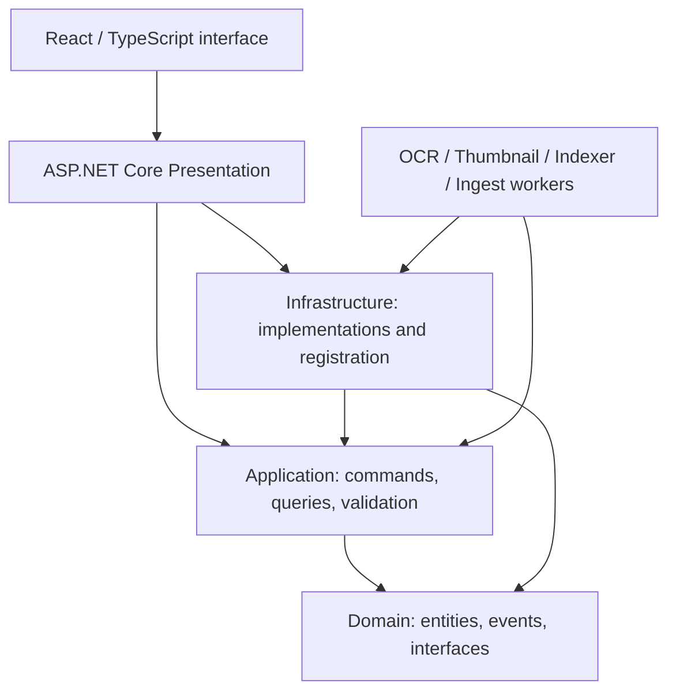
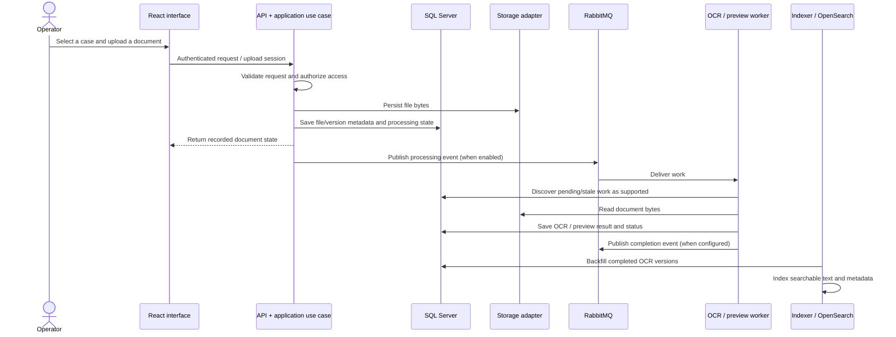

# Architecture

[Back to the project](../README.md)

## System context

ArchiveSystem supports an organization that needs to classify physical/digital case records, manage documents and versions, control who can see or change them, and locate documents by metadata or extracted text. The primary deployment is a private network with locally operated storage and processing services.

The public edition preserves the application's module boundaries. It removes deployment data and provides a separate frontend-only showcase; that showcase is not an alternative implementation of the backend.

## Code organization and dependencies

| Module | Responsibility | Read first |
| --- | --- | --- |
| Domain | Case, classification, file/version, dynamic value, audit and loan models. | [`Entities/`](../src/ArchiveSystem.Domain/Entities/) |
| Application | Feature-oriented use cases, repositories/interfaces, validation and authorization helpers. | [`Features/`](../src/ArchiveSystem.Application/Features/) |
| Infrastructure | SQL/EF Core, Identity, object storage, messaging, search and external-system implementations. | [`DependencyInjection.cs`](../src/ArchiveSystem.Infrastructure/DependencyInjection.cs) |
| API | HTTP endpoints, error handling, bearer authentication, policies, rate limiting and health checks. | [`Program.cs`](../src/ArchiveSystem.Presentation.Api/Program.cs) |
| Frontend | Routes, React Query requests, Zustand state, Material UI components and RTL styling. | [`App.tsx`](../src/ArchiveSystem.Frontend/src/App.tsx) |
| Workers | OCR, preview generation, indexing/backfill and folder ingestion. | Each worker's `Program.cs` and `Workers/` directory. |
| Scanner Bridge | Local HTTP adapter to Windows scanner tooling. | [`Program.cs`](../src/ArchiveSystem.ScannerBridge/Program.cs) |

These are dependency directions visible in the code, not a claim of perfectly isolated layers. Application currently references EF Core and ASP.NET abstractions; some workflows still contain legacy or overlapping models. This is a modular application with separate worker processes, not a set of independently owned microservices.

## Record and file lifecycle

The diagram combines supported event and polling paths; actual enabled consumers depend on worker configuration. It does not imply an atomic transaction across SQL, object storage and RabbitMQ. Review failure recovery and idempotency before promising delivery guarantees.

## Persistence and storage

- **SQL Server** stores relational metadata, Identity records, ACLs, audit records, upload state, file versions and processing results.
- **EF Core migrations** are retained so the schema can be reproduced. Startup migration behavior is configurable through `Migration` settings.
- **MinIO/S3** holds document bytes when the object-storage adapter is selected.
- **SQL FILESTREAM** is an alternate implementation, requiring a separately provisioned compatible SQL Server environment; the Linux Compose example selects MinIO.
- **OpenSearch** is the full-text index. The Indexer worker also scans completed OCR versions to backfill the index.
- **Redis** is optional distributed caching; registration falls back to in-memory distributed cache when no Redis connection is configured.

## Processing workers

| Worker | Behavior represented in code | External prerequisites |
| --- | --- | --- |
| OCR | Reads pending document versions, extracts native PDF text where enabled, runs RapidOCR, stores structured/text output, and resets stale work. | Correct ONNX models, recognition dictionary and compatible native runtime. |
| Thumbnail | Produces document/image previews with its own polling/processing loop and optional queue consumer. | Supported decoders and storage access. |
| Indexer | Indexes completed OCR results and performs periodic backfill. | Reachable OpenSearch endpoint and SQL database. |
| Scanner Ingest | Watches configured folders and imports scan output. | Explicitly configured writable folders and service credentials. |

OCR model files are intentionally absent. `RapidOcrEngineOptions` documents the expected paths; the worker validates its runtime and preserves pending jobs when initialization fails. No OCR accuracy benchmark is claimed by this repository.

## Authorization and audit

The source combines ASP.NET Core Identity, JWT bearer authentication, permissions, classification/tag ACLs, and application-level checks. The frontend uses the session's roles/permissions to adapt navigation, while server-side authorization remains authoritative. Request correlation, structured errors, logging, upload constraints, and OTP rate limiting are also represented.

This is an implementation overview, not a security certification. External SMS/OTP providers, secrets, reverse-proxy TLS, database permissions, retention and backup policies must be configured and tested for the intended environment.

## Scanner boundary

The Scanner Bridge is a separate localhost service. It exposes health, scanner enumeration and scan endpoints, validates allowed origins, and delegates to NAPS2 console tooling. WIA/TWAIN device support requires Windows and a real device. The folder-ingest worker and the desktop bridge are distinct integration paths.

## Frontend showcase boundary

`npm run showcase` sets Vite's named `showcase` mode, seeds a clearly synthetic session, and installs a rejecting Axios adapter. The existing offline fallback supplies sample records. Normal application builds do not install that adapter or seed the session. Routes without an offline implementation may display an unavailable state.

The screenshots are produced from this mode and contain an in-app demo label. They are evidence of UI rendering only.
