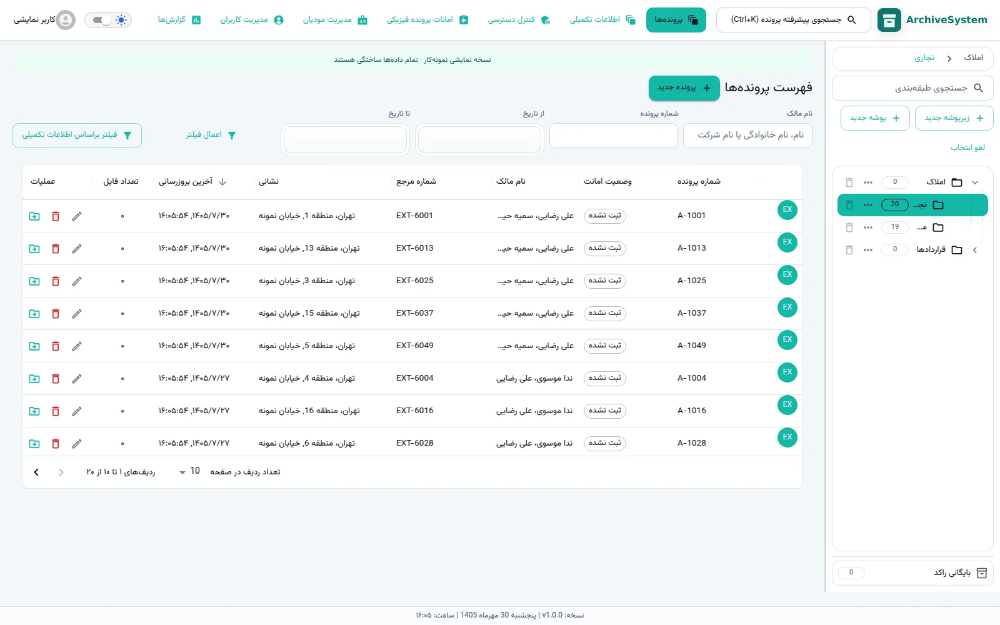
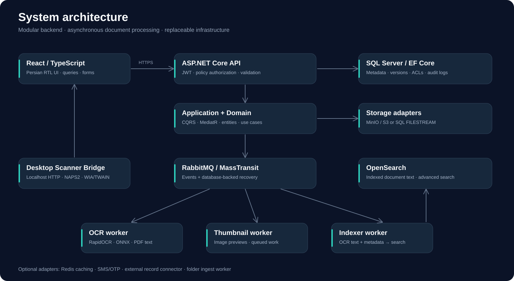

# آرشیو اسناد و پرونده‌ها — ArchiveSystem

<!-- project-contact:start -->
**درخواست پروژه و همکاری با یوسف عمرانی:** [ارسال ایمیل](mailto:aliomrani916@gmail.com) · **aliomrani916@gmail.com** · [خدمات و تماس](https://ali771025.github.io/software-portfolio/contact/) · [معرفی نمونه‌کار](https://ali771025.github.io/software-portfolio/work/ArchiveSystem/)
<!-- project-contact:end -->


[صفحه اصلی و تصاویر](../README.md) · [معماری](ARCHITECTURE.md) · [راهنمای اجرا](GETTING_STARTED.md)

**یک نمونه‌کار نرم‌افزاری برای مدیریت اسناد و پرونده‌ها، با رابط فارسی و راست‌به‌چپ، بک‌اند .NET و پردازش پس‌زمینه.**

این سامانه طبقه‌بندی سلسله‌مراتبی، پرونده‌ها، مالکین، فایل و نسخه‌های آن، اطلاعات تکمیلی پویا، کنترل دسترسی، ثبت رویدادها و امانت پرونده فیزیکی را در یک محیط تحت وب کنار هم قرار می‌دهد. سرویس‌های جداگانه برای OCR، تصویر بندانگشتی، ایندکس جستجو و دریافت خروجی اسکنر در سورس وجود دارند.



## اجرای سریع نسخه نمایشی

پیش‌نیاز: Node.js نسخه ۲۲٫۱۲ یا جدیدتر و npm.

```bash
git clone https://github.com/Ali771025/ArchiveSystem.git
cd ArchiveSystem/src/ArchiveSystem.Frontend
npm ci
npm run showcase
```

نشانی محلی نمایش‌داده‌شده در ترمینال را باز کنید. این حالت با حساب نمایشی و داده‌های ساختگی اجرا می‌شود و درخواست‌های API آن به بک‌اند ارسال نمی‌شوند. بعضی بخش‌هایی که آداپتر نمایشی ندارند برای عملکرد کامل به سرویس‌های اصلی نیاز دارند. تغییرات داده‌های نمایشی دائمی نیست.

## معماری و فناوری‌ها

- **بک‌اند:** ASP.NET Core / .NET 8، MediatR، FluentValidation و EF Core.
- **رابط:** React، TypeScript، Material UI، React Query و Zustand.
- **زیرساخت:** SQL Server، MinIO/S3، RabbitMQ و OpenSearch؛ Redis اختیاری.
- **پردازش:** workerهای OCR، پیش‌نمایش و ایندکس جستجو.
- **اسکنر:** سرویس محلی مستقل با اتصال NAPS2 و نیاز به ویندوز/تجهیزات واقعی برای WIA/TWAIN.



## حدود نسخه عمومی

این مخزن یک نسخه سورس مناسب ارزیابی نمونه‌کار است. قراردادها، اسناد و تصاویر واقعی اشخاص، تنظیمات خصوصی، رمزها، تاریخچه قبلی، خروجی ساخت، پوشه بسته‌ها و مدل‌های باینری OCR منتشر نشده‌اند. تصاویر رابط با داده‌های ساختگی تهیه شده‌اند. مدل OCR، صحت عددی استخراج اطلاعات و کارکرد اسکنر واقعی باید جداگانه فراهم و ارزیابی شوند.

نتایج واقعی ساخت و آزمون در [گزارش اعتبارسنجی](VALIDATION.md) آمده است؛ آماده‌بودن برای استفاده عملیاتی از روی ظاهر رابط نتیجه‌گیری نمی‌شود.

## همکاری

اگر برای توسعه سامانه‌های داخلی، مدیریت پرونده و اسناد، رابط فارسی، APIهای .NET، اتصال سرویس‌ها یا استقرار در شبکه داخلی به همکاری نیاز دارید، از طریق [پروفایل GitHub](https://github.com/Ali771025) یا [ثبت درخواست در مخزن](https://github.com/Ali771025/ArchiveSystem/issues/new) ارتباط بگیرید.

برای استفاده مجدد از کد، درباره مجوز و دامنه همکاری با صاحب مخزن هماهنگ کنید. مجوزها و نام‌های صاحبان کتابخانه‌ها و فونت‌های ثالث محفوظ‌اند.
